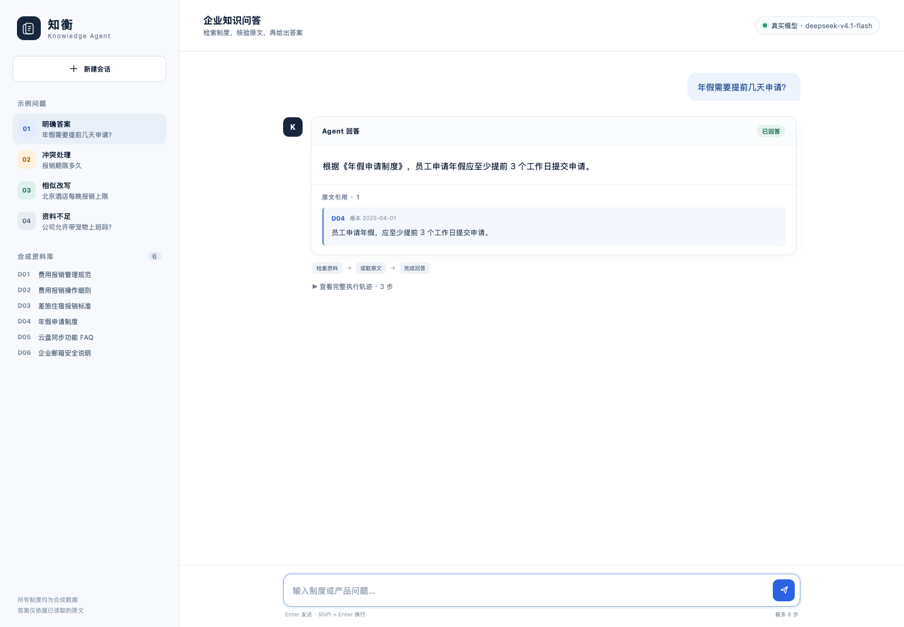
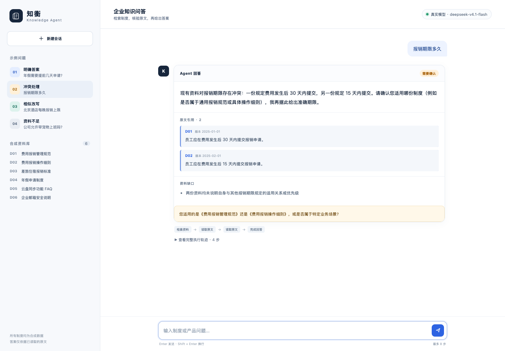

# 企业知识问答 Agent

小影科技 2027 校招 AI Agent 笔试项目。Agent 通过“模型选择动作 → 调用本地工具 → 观察结果 → 模型继续决策”的循环，回答制度与产品问题，并返回原文引用、资料缺口和任务状态。

## 核心保证

- 真实模式每轮由模型重新选择 `search_documents`、`read_document` 或 `finish`，没有预设执行骨架。
- 只有本轮成功读取的原文可用于引用；程序逐字校验 `doc_id + quote`，错误引用会反馈给模型修正。
- 冲突资料需并列说明并追问适用制度，不按日期或 ID 擅自选答案。
- 默认最多 8 步；超限返回 `max_steps_exceeded`，不会输出未经核验的答案。
- 离线 Mock 仅验证流程，**不证明真实模型决策效果**，所有记录均标注 `model_mode`。

## 环境与安装

- Python 3.11+，仅使用标准库，无第三方运行时依赖。
- 本项目已用 Python 3.13.12 验证。

```bash
python3 --version
python3 -m pip install -r requirements.txt  # 可选，无实际第三方依赖
```

以下命令均在仓库根目录执行。

## Web 界面（推荐）

界面支持连续对话、示例问题、资料库浏览、原文引用、资料缺口和完整 ReAct 轨迹，并明确标识真实模型或离线 Mock。

```bash
# 无模型密钥时，启动离线流程演示
PYTHONPATH=src python3 -m knowledge_qa.web --mock

# 按下方“真实模型运行”配置环境变量后，去掉 --mock 即可使用真实模型
PYTHONPATH=src python3 -m knowledge_qa.web
```

默认监听 `127.0.0.1:8000`，打开 http://127.0.0.1:8000 。可用 `--port 8001` 更换端口。原 CLI 方式继续保留。

### 示例：明确答案与原文引用

真实模型读取 D04 后回答年假申请时限，页面展示版本日期、逐字引用和执行路径。



### 示例：制度冲突与追问

真实模型读取 D01、D02 后，同时呈现 30 天与 15 天、资料缺口和适用制度追问，不擅自选择答案。



## 快速运行（离线流程 Mock CLI）

```bash
PYTHONPATH=src python3 -m knowledge_qa.cli \
  --mock \
  --question "报销期限多久" \
  --trace examples/manual_conflict.json
```

输出包含 `request`、`result` 和 `trace`。预期状态为 `needs_clarification`，同时引用 D01 的 30 天和 D02 的 15 天，并询问适用制度。

上下文追问：

```bash
PYTHONPATH=src python3 -m knowledge_qa.cli --mock \
  --question "那上海呢？" \
  --history '[{"role":"user","content":"北京出差住宿报销标准是多少？"},{"role":"assistant","content":"北京每间每晚不超过 500 元。"}]'
```

工具故障注入：

```bash
PYTHONPATH=src python3 -m knowledge_qa.cli --mock \
  --question "北京住宿标准是多少？" \
  --fail-tool read_document --fail-doc-id D03
```

## 真实模型运行

需要兼容 OpenAI Chat Completions 且支持 JSON object 响应的模型服务。不要把真实密钥提交到仓库。

```bash
cp .env.example .env
# 编辑 .env，填写 OPENAI_API_KEY 和 OPENAI_MODEL
set -a; source .env; set +a

PYTHONPATH=src python3 -m knowledge_qa.cli \
  --question "报销期限多久" \
  --trace examples/real_conflict.json
```

`OPENAI_BASE_URL` 默认是 `https://api.openai.com/v1`，也可改为其他兼容服务。模型不可用时会返回 `model_error`，不会降级冒充真实决策。

已使用本地 OpenAI 兼容服务和 `deepseek-v4.1-flash` 生成 8 组真实模型记录，覆盖全部验收场景、工具失败恢复、资料替换和步数上限。索引见 [examples/real_manifest.json](examples/real_manifest.json)，结果与限制见评估文档。凭据未写入这些材料。

## 测试与评审入口

```bash
# 12 项自动化测试
PYTHONPATH=src python3 -m unittest discover -s tests -v

# 重新生成 7 组离线输入、实际输出和 Trace
python3 scripts/generate_examples.py
```

优先查看：

1. [docs/01-requirements.md](docs/01-requirements.md)：范围与验收矩阵。
2. [docs/02-solution.md](docs/02-solution.md)：ReAct 循环、冲突处理与技术取舍。
3. [docs/03-evaluation.md](docs/03-evaluation.md)：预期、实际结果、证据边界和限制。
4. [examples/real_manifest.json](examples/real_manifest.json)：8 组真实模型运行记录索引。
5. [examples/manifest.json](examples/manifest.json)：7 组离线流程记录索引。
6. [examples/test-results.txt](examples/test-results.txt)：实际测试输出。

## 自定义资料

资料是包含 `doc_id`、`title`、`version_date`、`content` 的 JSON 数组：

```bash
PYTHONPATH=src python3 -m knowledge_qa.cli --mock \
  --data data/documents_replaced.json \
  --question "上海住宿报销上限是多少？"
```

替换版 D03 将 500 元改为 600 元；对应示例的答案和引用会同步改变。

## 输出字段

- `status`：`completed`、`needs_clarification`、`insufficient_information`、`tool_error`、`max_steps_exceeded` 或 `model_error`。
- `answer`：面向员工的回答；冲突时列出不同规定，不擅自裁决。
- `citations`：文档 ID、版本日期、逐字原文片段。
- `gaps`：缺失的适用范围、优先级、相关资料或重试条件。
- `clarifying_question`：需要用户确认时的问题。
- `trace`：每步动作、工具参数、返回摘要、简短决策依据和后续动作；不包含模型内部思维过程。

## 目录

```text
src/knowledge_qa/   Agent、模型适配器、工具与 CLI
tests/              可执行 unittest 验收测试
examples/           输入、实际输出、Trace、测试结果
data/               原始与替换版合成资料
docs/               需求、方案、评估、AI 使用与复盘
scripts/            离线示例再生成脚本
```

真实模型结果、实际失败修复和已知限制见 [docs/03-evaluation.md](docs/03-evaluation.md)。
